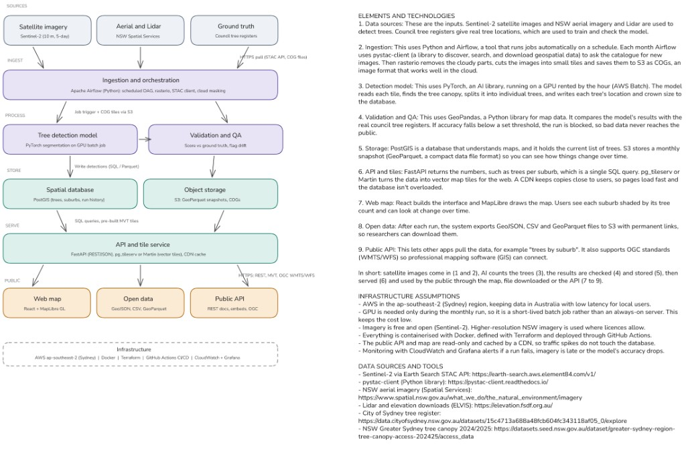

# Sydney Trees: Part 2 demo

A small, runnable version of the production system for counting Sydney's trees.
[`notebooks/part2_walkthrough.ipynb`](notebooks/part2_walkthrough.ipynb) walks through the
nine boxes of the system diagram in order. It runs real code on a 600 m x 600 m area of Redfern
and shows each step's output. The notebook is committed with its outputs, so it can be read on GitHub without running anything.



## Layout

| Path | What it is |
|---|---|
| `pipeline/steps.py` | One function per step: `search_sentinel`, `make_ndvi_cog`, `fetch_aerial_chips`, `load_register`, `load_suburbs`, `detect_trees`, `validate`, `qa_gate`, `store_run`, `export_open_data` |
| `pipeline/dag.py` | The Airflow DAG that wraps the same functions (shown in the notebook, not run) |
| `pipeline/webmap.py` | The MapLibre GL page and static PNG |
| `api/main.py` | FastAPI: `/runs`, `/suburbs`, `/suburbs/{name}`, `/trees?bbox=`, OGC API Features (`/`, `/conformance`, `/collections/...`), `/tiles/{z}/{x}/{y}.mvt` |
| `notebooks/part2_walkthrough.ipynb` | The walkthrough, with outputs |
| `outputs/` | `map.html`, `map.png` and the open data files |
| `docs/data-access.md` | Endpoints, protocols and limits for each data source |
| `scripts/` | `warm_cache.py` (download everything and run detection once), `build_notebook.py` (regenerate the notebook) |

## Run it

Needs Python 3.11 and [uv](https://docs.astral.sh/uv/).

```bash
uv sync
uv run python scripts/warm_cache.py      # first time only: downloads data, runs detection (~15 min on CPU)
uv run jupyter lab notebooks/part2_walkthrough.ipynb
```

**Optional: the lidar check (section 3b).** It removes detections that are roofs or shrubs. The NSW lidar
bucket is Requester Pays, so order the tiles free from [ELVIS](https://elevation.fsdf.org.au): draw the
demo area, choose *NSW Government - Spatial Services > Point Clouds*, and select the two `Sydney202005-LID1-C3-AHD_...laz`
files. Save them to `data/cache/lidar/` and re-run the notebook. Without them the step is skipped.

After the first run everything is cached in `data/cache/`, so the notebook re-runs in about a minute and works offline
(apart from basemap tiles not already cached). To run the API as a real server:

```bash
uv run uvicorn api.main:app --reload     # http://127.0.0.1:8000/docs
```

Then open `outputs/map.html` in a browser, or add `http://127.0.0.1:8000` in QGIS as an OGC API Features layer.

## Local stand-ins

| Production | Here |
|---|---|
| Airflow | Step functions called directly; DAG printed |
| AWS Batch GPU | DeepForest on CPU |
| PostGIS | DuckDB spatial (same SQL) |
| S3 | `data/s3/` (same key layout) |
| FastAPI behind CloudFront, Martin tiles | `api/main.py`, called in-process with `TestClient` |
| React + MapLibre GL | `outputs/map.html` |

## Data attribution

- Sentinel-2 L2A: Copernicus, via Element 84 Earth Search.
- Aerial imagery and suburb boundaries: (c) NSW Spatial Services, CC BY 4.0.
- Tree register: (c) City of Sydney, CC BY 4.0.
- Tree detection model: [DeepForest](https://github.com/weecology/DeepForest) (Weinstein et al.), MIT licence.
